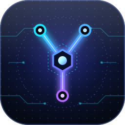

<p align="center"></p>

<p align="center">
<a href="https://github.com/sinabs/spring-agent-scope/actions/workflows/gradle.yml"></a>


<a href="LICENSE"></a>
</p>

<p align="center">English | <a href="README_CN.md">简体中文</a></p>

## About Yoke

**Yoke** · AgentHarness: a monolithic agent service built on Spring Boot and [AgentScope Java](https://github.com/agentscope-ai/agentscope-java) (V2).

> A Spring-based agent harness.

A yoke is the wooden frame that makes oxen and horses pull in the direction you want. Yoke does the same for models: it is the runtime layer wrapped around a model so it can do real work reliably. It turns AgentScope's agent capabilities into a ready-to-use HTTP service, so you can focus on your business logic instead of glue code:

- One endpoint for multi-turn conversations: `POST /api/chat`.
- A temporary agent is built for every request and closed afterwards; conversation history lives in a shared state store and is isolated per session.
- Models are plugged in through the official AgentScope starters: OpenAI-compatible APIs (works with DashScope, DeepSeek and others), Anthropic, Gemini and Ollama. Switching is a dependency and configuration change.
- `local` / `test` / `prod` profiles. In production, a missing API key fails the startup instead of shipping with an empty key.
- Virtual threads are enabled by default, for both Tomcat and Spring's default thread pool.
- Request validation: a missing `message` returns 400.

## Getting Started

Requires JDK 25.

```bash
sdk env                         # switch to JDK 25 (if you use sdkman)
export OPENAI_API_KEY=sk-...
./gradlew bootRun               # the local profile is active by default
```

```bash
curl -X POST localhost:8080/api/chat \
  -H 'Content-Type: application/json' \
  -d '{"message": "Hello"}'
# {"sessionId":"…","reply":"…"}
```

Send the returned `sessionId` with later requests to continue the same conversation; conversations with different `sessionId`s are isolated from each other. Run the tests with `./gradlew build`.

> **Note**
> The default in-memory state store only suits a single process, and history is lost when the service restarts. For multi-instance deployments, switch to a Redis or JDBC implementation. Concurrent requests for the same session are not serialized, so avoid sending them at the same time.

## Configuration

Configuration is split by profile. The `local` profile is active when none is specified; switch with the `SPRING_PROFILES_ACTIVE=prod` environment variable or the `--spring.profiles.active=prod` command-line argument.

- `application.yml`: Shared by all profiles: model, agent, virtual threads, log format
- `application-local.yml`: Local development: API key from the environment (may be empty), `com.yoke` logs at debug
- `application-test.yml`: Automated tests: a fake API key, the model is never really called
- `application-prod.yml`: Production: the API key must come from the environment, startup fails without it; graceful shutdown

The model is created by the official AgentScope starter from `agentscope.*`, and the agent is built per request by a shared builder (the official singleton agent is turned off):

| Property | Description |
|---|---|
| `agentscope.openai.api-key` | Model API key, taken from the `OPENAI_API_KEY` environment variable |
| `agentscope.openai.model-name` | Model name |
| `agentscope.openai.base-url` | Set this to use another OpenAI-compatible service (DashScope, DeepSeek, ...) |
| `agentscope.agent.sys-prompt` | System prompt |
| `agentscope.agent.max-iters` | Maximum number of ReAct iterations |

To use another model, replace `agentscope-openai-spring-boot-starter` in `build.gradle` with the matching starter (dashscope, anthropic, gemini or ollama) and change `agentscope.model.provider`.

## Project Structure

```
src/main/java/com/yoke/
├── YokeApplication.java        Application entry point
├── api/                        HTTP contract (ChatApi: paths, validation and docs live here)
├── config/                     Shared agent configuration (builder, state store)
├── controller/                 Contract implementation (ChatController)
└── model/                      Request and response objects (ChatRequest, ChatResponse)
src/main/resources/             application.yml and the per-profile configuration
docs/brand/                     Logo
```

## Learn More

- [AgentScope Java documentation](https://java.agentscope.io): the full guide to agents, tools, permissions, state stores and more.

## Contributing

Issues and pull requests are welcome. Before submitting, run `./gradlew build` and make sure all tests pass. Code comments are written in Chinese.

## License

Yoke is open-sourced software licensed under the [Apache License 2.0](LICENSE).

## Star History

[](https://star-history.com/#sinabs/spring-agent-scope&Date)
