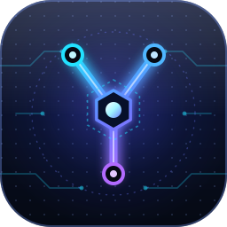

<p align="center"></p>

<p align="center">
<a href="https://github.com/sinabs/spring-agent-scope/actions/workflows/gradle.yml"></a>


<a href="LICENSE"></a>
</p>

<p align="center">English | <a href="README_CN.md">简体中文</a></p>

## About Yoke

**Yoke** · AgentHarness: a monolithic agent service built on Spring Boot and [AgentScope Java](https://github.com/agentscope-ai/agentscope-java) (V2).

> A Spring-based agent harness.

Yoke is an open-source project of 友客AI (YouKe AI). We read the AgentScope Java V2 and Spring source code together and learn by building an agent service that really runs. A yoke is the wooden frame that makes oxen and horses pull in one direction. Yoke wraps around the model and keeps it working reliably.

- Building an agent with AgentScope Java: the demo runs in a dozen lines. Serving real users is where it gets hard. Should each request get a new agent, or share one global agent? Where does the conversation history live?
- Streaming, tool calls, multi-turn sessions and tight permissions are scattered across the official examples. Fitting them into one Spring Boot project, deciding how to layer it and which boundaries must hold, is left to you.
- The official starters are one line away, but their endpoints have no authentication and the agent is a singleton, so shipping them as they are mixes sessions of different users. This project gives a judgement on what to use and what to write yourself.
- The project starts from an endpoint that can hold a conversation and solves one engineering problem per lesson. The code is open source and runs as is. Limits that were not verified and pitfalls hit along the way are written down too.

### Features

- One endpoint for multi-turn conversations: `POST /api/chat`, plus `POST /api/chat/stream` that streams the reasoning process over SSE using the AG-UI protocol.
- A built-in `get_weather` tool looks up current weather through the open-source [Open-Meteo](https://open-meteo.com) API, no key needed (the free tier is for non-commercial use only).
- Every request builds a temporary `HarnessAgent` and closes it afterwards. Conversation history lives in Redis, so it survives restarts and is shared by all replicas, isolated per `(userId, sessionId)`, and compacted automatically when a conversation gets long.
- Tools, knowledge and sub-agents: calculator, clock and per-user notes tools, a `retrieve` tool over a built-in knowledge base that returns citations keyed by stable passage ids such as `[doc-name.md#passage-id]`, external MCP servers over HTTP, and two sub-agents (one declared in code, one declared as a workspace Markdown file). The agent still has no file, shell or web tools, and a logging middleware records a timing trace for every call.
- Models are plugged in through the official AgentScope starters: OpenAI-compatible APIs (works with DashScope, DeepSeek and others), Anthropic, Gemini and Ollama. Switching is a dependency and configuration change.
- `local` / `test` / `prod` profiles. In production, a missing API key fails the startup instead of shipping with an empty key.
- Virtual threads are enabled by default, for both Tomcat and Spring's default thread pool.

## Getting Started

Requires JDK 25 and Docker (for the local Redis).

```bash
docker compose up -d            # start Redis first; the app refuses to start without it
sdk env                         # switch to JDK 25 (if you use sdkman)
export ARK_API_KEY=...          # the local profile talks to Volcengine Ark (OpenAI-compatible)
./gradlew bootRun               # the local profile is active by default
```

```bash
curl -X POST localhost:8080/api/chat \
  -H 'Content-Type: application/json' \
  -d '{"message": "Hello"}'
# {"sessionId":"…","reply":"…"}
```

Send the returned `sessionId` with later requests to continue the same conversation. Run the tests with `./gradlew build`; tests that need a real Redis start it from the same `docker-compose.yml` through Testcontainers, and are skipped with a clear reason when Docker is not available (with `CI=true` they fail instead).

### Sessions

History is stored per `(userId, sessionId)`. Both are optional in the request body (`{"userId": "alice", "sessionId": "s-1", "message": "Hello"}`), and the server always makes sure both have a value before the agent sees them:

- both given: that pair
- only `sessionId`: it belongs to the `default` user (same as older clients)
- only `userId`: a new session is created for that user, and its id is returned in the response
- neither: a new session under the `default` user

A half-empty pair is never passed on to the framework, because in AgentScope 2.0.4 a missing `sessionId` falls into one shared session named after the agent, and a missing `userId` falls into an anonymous user, which would mix everyone's history together. Both ids may only contain letters, digits, `_`, `.` and `-` (1 to 64 characters, not all dots, so `.` and `..` are rejected); anything else returns 400. The framework joins them as `userId/sessionId`, so allowing `/` would let different pairs collide on one slot, and `userId` also becomes a workspace directory name. There is no authentication yet: `userId` is whatever the caller says, so it is not an identity check.

What is stored in Redis, per session (checked against a real model, two turns with one tool call):

| Key | Type | Content |
|---|---|---|
| `yoke:session:{userId}/{sessionId}:agent_state` | String | One JSON document with the whole agent state. The conversation is its `context` array (one entry per message: `USER`, `ASSISTANT` with `tool_use`, `TOOL` with `tool_result`, ...), next to a `summary` field and a few empty context objects. `summary` stayed empty in a real compaction run: the compaction summary is stored as the first message of `context` instead. About 3.3 KB for two turns |
| `yoke:session:{userId}/{sessionId}:agent_state:ver` | String | Version number used for optimistic concurrency, bumped on every save |
| `yoke:session:{userId}/{sessionId}:_keys` | Set | Names of all state keys of the session (only `agent_state` here), used to delete a whole session |

The model's `thinking` blocks and per-message token usage are stored too, and the whole document is read and written back on every turn, so it grows with the conversation. There is no separate message list key.


### Streaming (AG-UI)

`POST /api/chat/stream` speaks the [AG-UI](https://docs.ag-ui.com/concepts/events) protocol: the request body is a standard `RunAgentInput`, and the response is a `text/event-stream` of AG-UI events pushed while the agent is reasoning. Use `curl -N` to turn off buffering:

```bash
curl -N -X POST localhost:8080/api/chat/stream \
  -H 'Content-Type: application/json' \
  -d '{"threadId": "demo", "runId": "run-1", "messages": [{"id": "msg-1", "role": "user", "content": "What is the weather in Beijing?"}]}'
```

Request rules (any violation returns 400 before the stream starts):

- `Content-Type` must be `application/json`, otherwise 415. This also stops a cross-site page from starting a run with a `text/plain` request that skips the CORS preflight
- `threadId` is the session ID and is required: letters, digits and `_.-`, 1 to 64 characters, not all dots. It shares the same history as `sessionId` of `POST /api/chat` of the `default` user (`RunAgentInput` has no user field, so the streaming endpoint always runs as `default`)
- `runId` is required and must not be blank (`RunAgentInput` requires it)
- `messages` must not be empty, every message needs an `id` and a `role`, and the last one must be a `user` message with non-blank plain text. `content` must be a string: content blocks (even text-only ones, or with images) are rejected
- The server keeps the history itself and only uses the **last** `user` message. Earlier messages, `tools`, `context`, `state`, `forwardedProps` and `resume` are ignored, so a client cannot add tools to the agent or rewrite the history. Only the text of that message is kept: its `id`, `toolCalls` and `toolCallId` never reach the history, and the message ID is generated on the server. The adapter is also configured with `ToolMergeMode.AGENT_ONLY`, so only server-registered tools are ever used

Illustrative output (values are made up, field names come from real runs against a stub model, long fields are elided). Only `data:` lines are sent; the event type is the `type` field in the JSON, there is no SSE `event:` name:

```
data:{"type":"RUN_STARTED","threadId":"demo","runId":"…","input":{…}}

data:{"type":"TOOL_CALL_START","threadId":"demo","runId":"…","toolCallId":"call_1","toolCallName":"get_weather"}

data:{"type":"TOOL_CALL_ARGS","threadId":"demo","runId":"…","toolCallId":"call_1","delta":"{\"city\":\"Beijing\"}"}

data:{"type":"TOOL_CALL_END","threadId":"demo","runId":"…","toolCallId":"call_1"}

data:{"type":"TOOL_CALL_RESULT","threadId":"demo","runId":"…","toolCallId":"call_1","content":"\"Sunny, 25 C\"","role":"tool","messageId":"…"}

data:{"type":"TEXT_MESSAGE_START","threadId":"demo","runId":"…","messageId":"…","role":"assistant"}

data:{"type":"TEXT_MESSAGE_CONTENT","threadId":"demo","runId":"…","messageId":"…","delta":"It is sunny, 25 C."}

data:{"type":"TEXT_MESSAGE_END","threadId":"demo","runId":"…","messageId":"…"}

data:{"type":"CUSTOM","threadId":"demo","runId":"…","name":"token_usage","value":{"delta":{…},"cumulative":{"inputTokens":83,"outputTokens":27,…},"modelCall":{…}}}

data:{"type":"RUN_FINISHED","threadId":"demo","runId":"…"}
```

| Event `type` | Meaning |
|---|---|
| `RUN_STARTED` | Always the first event, carries `threadId` and `runId` |
| `TEXT_MESSAGE_START` / `TEXT_MESSAGE_CONTENT` / `TEXT_MESSAGE_END` | Generated text; concatenate the `delta` of the `CONTENT` events in order to get the reply |
| `TOOL_CALL_START` / `TOOL_CALL_ARGS` / `TOOL_CALL_END` | A tool the model decided to call; `TOOL_CALL_ARGS` carries fragments of the arguments JSON and only appears when the model streams the arguments in pieces |
| `TOOL_CALL_RESULT` | The result of a tool, matched to the call by `toolCallId` |
| `CUSTOM` with `name` = `token_usage` | Token usage after each model call, with `delta` and `cumulative` |
| `CUSTOM` with `name` = `hint` | A hint the framework adds during reasoning, `value` has `source` and `text` |
| `RUN_FINISHED` | The normal end |
| `RUN_ERROR` | Reasoning failed; the HTTP status is still 200 and the stream ends normally instead of dropping the connection. The message is the raw exception message and is not redacted, so do not show it to end users directly |

Every stream starts with `RUN_STARTED`, even when the agent cannot be created, and ends with either `RUN_FINISHED` or `RUN_ERROR`, never both. When the agent fails while running, the AG-UI adapter maps the exception to `code` (`TIMEOUT_ERROR`, `INTERRUPTED_ERROR`, `INVALID_INPUT_ERROR` or `INTERNAL_ERROR`); failures outside the adapter, such as the agent not being created, are always `INTERNAL_ERROR`. There is no `done` event and the final text is not repeated: the client concatenates `TEXT_MESSAGE_CONTENT`. The temporary agent is closed when the stream completes, fails or the client disconnects. The adapter's `runTimeout` setting is not read by AgentScope 2.0.4, so it does not limit the run time.

> **Breaking change**
> The earlier private events (`textDelta`, `toolCall`, `toolResult`, `hint`, `done`, `error`) and the `{"sessionId", "message"}` request body of the streaming endpoint are gone. The streaming endpoint now only accepts `Content-Type: application/json`; requests without a `Content-Type`, or with `text/plain` or `application/*+json`, get 415. `POST /api/chat` now validates `sessionId` with the same rule as `threadId` (non-blank values like `user:42` used to be accepted and now return 400); a blank `sessionId` still starts a new session.

> **Note**
> Concurrent requests for the same session are not serialized, so avoid sending them at the same time. `HarnessAgent.close()` waits for the framework's global async-write quiescence (up to 5 seconds each for two waits) inside the per-request cleanup, so requests are coupled through it; this has not been load-tested.

## Configuration

Configuration is split by profile. The `local` profile is active when none is specified; switch with the `SPRING_PROFILES_ACTIVE=prod` environment variable or the `--spring.profiles.active=prod` command-line argument.

- `application.yml`: Shared by all profiles: model, agent, virtual threads, log format, workspace, key prefix, compaction, knowledge-base embedding and the (commented) MCP example
- `application-local.yml`: Local development: Volcengine Ark `base-url` and model name live in the file, the API key comes from `ARK_API_KEY` (may be empty), Redis at `redis://127.0.0.1:6379` (the one from `docker-compose.yml`), `com.yoke` logs at debug
- `application-test.yml`: Automated tests: a fake API key, the model is never really called; the Redis address is injected by the tests
- `application-prod.yml`: Production: the API key and the Redis address (`YOKE_REDIS_URI`) must come from the environment, startup fails without them; graceful shutdown

The model is created by the official AgentScope starter from `agentscope.*`, and a `HarnessAgent` is built per request by `HarnessAgentFactory` (the official singleton agent is turned off):

| Property | Description |
|---|---|
| `agentscope.openai.api-key` | Model API key; `local` reads `ARK_API_KEY`, `prod` reads `OPENAI_API_KEY` |
| `agentscope.openai.model-name` | Model name |
| `agentscope.openai.base-url` | Set this to use another OpenAI-compatible service (DashScope, DeepSeek, ...) |
| `agentscope.agent.sys-prompt` | System prompt |
| `agentscope.agent.max-iters` | Maximum number of ReAct iterations |

Yoke's own settings use the `yoke.*` prefix:

| Property | Description |
|---|---|
| `yoke.redis.uri` | Redis connection string. No default in `prod` (`YOKE_REDIS_URI`); the application fails at startup if Redis cannot be reached |
| `yoke.redis.key-prefix` | Prefix of every Redis key, default `yoke:` |
| `yoke.compaction.trigger-messages` | Compact the conversation once it reaches this many messages, default 30 |
| `yoke.compaction.keep-messages` | Messages kept verbatim after a compaction, default 10. Values `<= 0`, or a keep count not smaller than the trigger count, fall back to the defaults |
| `yoke.workspace` | `HarnessAgent` workspace for local files (offloaded messages, memory), default `~/.yoke/workspace`; it stays on the machine and is not shared between replicas |
| `yoke.knowledge.embedding.model-name` / `api-key` / `base-url` / `dimensions` / `protocol` | Optional embedding service for vector retrieval. `protocol` defaults to `openai` (OpenAI-compatible `/embeddings`, batchable); use `ark-multimodal` for Volcano Ark multimodal embedding models such as `doubao-embedding-vision-251215` (`/embeddings/multimodal`, one request per text; the `local` profile uses it and reuses `ARK_API_KEY`). Vector retrieval is enabled only when both `model-name` and `api-key` (`YOKE_EMBEDDING_API_KEY`) are set; otherwise retrieval uses keywords only. If the service fails at runtime, retrieval falls back to keywords automatically |
| `yoke.mcp.servers[]` | External MCP servers, none by default. Each entry has `name`, `transport` (`sse` or `streamable-http` only), `url`, `timeout` (default 30s) and optional `headers`. `stdio` is rejected and the application fails at startup; so is a server that cannot be reached |

The agent is built without file, shell or web tools. Reading the 2.0.4 source shows that a sub-agent inherits only the file and shell switches, not the web switch, so the web tools are also denied through a `ToolsConfig` deny list (on top of `disableWebTools()` for the main agent), which is applied to the main agent, the built-in `general-purpose` sub-agent and every declared sub-agent. Passing an explicit `ToolsConfig` also stops 2.0.4 from reading `tools.json` from the workspace, which could otherwise declare `stdio` MCP servers (processes started on the host). The read-side memory and session tools (`memory_get`, `memory_search`, `session_history`, `session_list`, `session_search`) are denied by the same list: `memory_get` only checks that a path stays inside the workspace root, not inside the current user's directory, and `session_history` puts model-supplied IDs straight into a path, so they would let the model read other users' memory and sessions. The model sees exactly these tools: Yoke's own (`get_weather`, `get_current_time`, `calculate`, `list_my_notes`, `retrieve`), the framework's memory-writing, skill-loading, async-result, sub-agent and background-task tools (`memory_save` only appends to the fixed `MEMORY.md` and `memory/<date>.md` in the workspace, without a size limit), plus whatever the configured MCP servers publish. `ToolPermissionTests` asserts this list as an exact set, so a framework upgrade that adds a tool fails the build. A `MiddlewareBase` bean is attached to every new agent; `LoggingMiddleware` logs agent, model and tool timings without tool arguments or outputs. OpenTelemetry tracing is not attached by default: add an OpenTelemetry SDK and exporter and register an `OtelTracingMiddleware` bean when you need it.

## Tools, Knowledge and Sub-agents

- **Tools** (`com.yoke.tool`): plain classes with `@Tool` methods, registered once into a shared `Toolkit`. `calculate` uses a hand-written recursive-descent parser (no script engine, input length and nesting limits, division by zero reported as text). `list_my_notes` takes a `UserContext` parameter without `@ToolParam`: the framework injects it by type from the request's `RuntimeContext`, so the model never sees or forges the user id.
- **Retrieval**: the `retrieve` tool searches `src/main/resources/knowledge/*.md` and returns passages labelled with a stable id such as `[doc-name.md#passage-id]` (document name plus a digest of the passage text, so editing a passage changes its id and old citations never point at different text; two knowledge documents with the same file name in different classpath roots fail the startup) plus their source, which the model is asked to cite verbatim (ids stay unique across repeated retrievals in one conversation, unlike per-call `[1]`, `[2]` counters). It is the only retrieval channel; the framework's `knowledge()` auto-injection is deliberately not used. Retrieval is layered behind the application's own `RetrievePort` (no framework types): BM25 keyword search is always available, and with an embedding service configured a vector channel is added and the two are fused with RRF (constant 60); if one channel fails the other is used. Note that with embeddings enabled, user queries and the knowledge-base text are sent to the embedding provider. The framework's own `rag-simple` module is not used: the `core/rag` package is `@Deprecated(forRemoval = true)` in 2.0.4 and the module drags in Qdrant, Milvus, Elasticsearch, PostgreSQL, PDFBox, POI, Tika and more.
- **MCP**: only HTTP transports are accepted. Example:

  ```yaml
  yoke:
    mcp:
      servers:
        - name: docs
          transport: streamable-http   # or sse
          url: https://mcp.example.com/mcp
          timeout: 30s
          headers:
            Authorization: Bearer ${MCP_DOCS_TOKEN}
  ```

  Tools appear under the names the server publishes. In 2.0.4 an MCP tool runs without confirmation only if the server marks it `readOnlyHint`, and Yoke's HTTP API has no human confirmation channel (the turn would otherwise end silently at the tool call with an empty reply). So only tools declared read-only are registered; the others are skipped (their names are logged at INFO) and neither the main agent nor any sub-agent ever sees them.
- **Sub-agents**: `summarizer` is declared in code (`YokeSubagents`) with no tools; `kb-researcher` is declared by `src/main/resources/workspace/subagents/kb-researcher.md`, copied into `yoke.workspace/subagents/` at startup, and may only use `retrieve`. 2.0.4 silently lets a workspace file override a code declaration with the same id (and `general-purpose.md` would replace the built-in one), so Yoke scans the files actually present in `yoke.workspace/subagents/` (including leftovers and hand-placed ones, not just the shipped ones) and fails at startup on any such clash.

To use another model, replace `agentscope-openai-spring-boot-starter` in `build.gradle` with the matching starter (dashscope, anthropic, gemini or ollama) and change `agentscope.model.provider`.

## Project Structure

```
src/main/java/com/yoke/
├── YokeApplication.java        Application entry point
├── api/                        HTTP contract (ChatApi: paths, validation and docs live here)
├── codec/                      Conversion between domain types and framework types (MessageCodec, AguiStreamCodec, HintEventConverter)
├── config/                     Agent, Redis, AG-UI adapter, tool, knowledge and sub-agent configuration (HarnessAgentFactory, YokeProperties, YokeSubagents)
├── controller/                 Contract implementation (ChatController)
├── knowledge/                  Retrieval port and implementations: keyword, vector, RRF fusion (no framework types)
├── mcp/                        Connections to external MCP servers (HTTP transports only)
├── middleware/                 Agent middlewares (LoggingMiddleware)
├── model/                      Request and response objects (ChatRequest, ChatResponse)
└── tool/                       Tools exposed to the model (WeatherTool, ChatTools, RetrieveTool, UserContext)
src/main/resources/             application.yml, the per-profile configuration, knowledge/*.md and workspace/subagents/*.md
docker-compose.yml              Local Redis, also used by the integration tests
docs/brand/                     Logo
```

## Learn More

- [AgentScope Java documentation](https://java.agentscope.io): the full guide to agents, tools, permissions, state stores and more.

## Contributing

Issues and pull requests are welcome. AgentScope message and event types must not leak out of `codec` (and `middleware`, whose hook signatures need them), and the `knowledge` package must stay free of AgentScope types; `ArchitectureTests` enforces this. Before submitting, run `./gradlew build` and make sure all tests pass. Code comments are written in Chinese.

## License

Yoke is open-sourced software licensed under the [Apache License 2.0](LICENSE).

## Star History

[](https://star-history.com/#sinabs/spring-agent-scope&Date)
