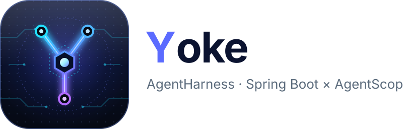

<p align="center"></p>

**Yoke** · AgentHarness：基于 Spring Boot 和 [AgentScope Java](https://github.com/agentscope-ai/agentscope-java)（V2）的单体 Agent 服务。

> A Spring-based agent harness.

Yoke（轭）是套在牛马身上、让它们听使唤拉车的木架；Yoke 则是套在模型外面、让它能稳定干活的那层运行框架。

## 技术栈

- JDK 25
- Spring Boot 4.1
- AgentScope Java 2.0
- Gradle 9.8（Groovy DSL，版本集中在 `gradle/libs.versions.toml`）
- Lombok、Jakarta Validation
- 虚拟线程：Tomcat 请求线程和 Spring 默认线程池都使用虚拟线程

## 快速开始

```bash
sdk env                         # 切换到 JDK 25（使用 sdkman 时）
export OPENAI_API_KEY=sk-...
./gradlew bootRun               # 默认激活 local 环境
```

```bash
curl -X POST localhost:8080/api/chat \
  -H 'Content-Type: application/json' \
  -d '{"message": "你好"}'
# {"sessionId":"…","reply":"…"}
```

后续请求带上返回的 `sessionId`，即可延续同一段对话；不同 `sessionId` 的对话历史互相隔离。

每次请求都会新建一个临时 Agent、用完关闭，对话历史保存在共享的状态存储里。默认的内存存储只适合单进程，重启后历史丢失；多副本部署时需要换成 Redis 或 JDBC 实现。同一会话的并发请求不会被串行化，请避免同时发送。

## 配置

配置按环境拆分，没有显式指定环境时默认激活 `local`；部署时用环境变量 `SPRING_PROFILES_ACTIVE=prod` 切换。

| 文件 | 用途 |
|---|---|
| `application.yml` | 各环境通用：模型、Agent、虚拟线程、日志格式 |
| `application-local.yml` | 本地开发：密钥读环境变量（可为空），`com.yoke` 日志为 debug |
| `application-test.yml` | 自动化测试：假密钥，不会真正调用模型 |
| `application-prod.yml` | 生产：密钥必须由环境变量提供，缺失则启动失败；优雅停机 |

模型由 AgentScope 官方 starter 根据 `agentscope.*` 创建，Agent 由共享 Builder 每次请求新建（官方的单例 Agent 已关闭）：

| 配置 | 说明 |
|---|---|
| `agentscope.openai.api-key` | 模型密钥，来自环境变量 `OPENAI_API_KEY` |
| `agentscope.openai.model-name` | 模型名称 |
| `agentscope.openai.base-url` | 接入其他 OpenAI 兼容服务（DashScope、DeepSeek 等）时设置 |
| `agentscope.agent.sys-prompt` | 系统提示词 |
| `agentscope.agent.max-iters` | ReAct 最大迭代次数 |

要换成其他模型，把 `build.gradle` 里的 `agentscope-openai-spring-boot-starter` 换成对应的 starter（dashscope、anthropic、gemini、ollama），并修改 `agentscope.model.provider`。

## 接口

`POST /api/chat`，请求体 `message` 必填（缺失返回 400），`sessionId` 可选。

## 目录

```
src/main/java/com/yoke/
├── YokeApplication.java        应用入口
├── api/                        HTTP 接口契约（ChatApi，路径、校验和文档都在这里）
├── config/                     Agent 共享配置（Builder、状态存储）
├── controller/                 接口实现（ChatController）
└── model/                      请求与响应对象（ChatRequest、ChatResponse）
src/main/resources/             application.yml 及各环境配置
docs/brand/                     logo
```
