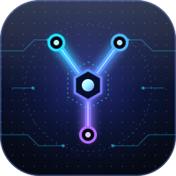

<p align="center"></p>

<p align="center">
<a href="https://github.com/sinabs/spring-agent-scope/actions/workflows/gradle.yml"></a>


<a href="LICENSE"></a>
</p>

<p align="center"><a href="README.md">English</a> | 简体中文</p>

## 关于 Yoke

**Yoke** · AgentHarness：基于 Spring Boot 和 [AgentScope Java](https://github.com/agentscope-ai/agentscope-java)（V2）的单体 Agent 服务。

> A Spring-based agent harness.

Yoke（轭）是套在牛马身上、让它们听使唤拉车的木架；Yoke 则是套在模型外面、让它能稳定干活的那层运行框架。它把 AgentScope 的 Agent 能力包装成一个开箱即用的 HTTP 服务，让你专注于业务，而不是胶水代码：

- 一个接口完成多轮对话：`POST /api/chat`；另有 `POST /api/chat/stream`，通过 SSE 边推理边推送。
- 内置 `get_weather` 工具，通过开源的 [Open-Meteo](https://open-meteo.com) 接口查询当前天气（无需密钥，免费版仅限非商业使用）。
- 每次请求新建临时 `HarnessAgent`，用完即关闭；对话历史保存在 Redis 里，重启不丢、多副本共享，按 `(userId, sessionId)` 隔离，对话过长时自动压缩。
- 除 `get_weather` 外 Agent 没有其他工具：不开放文件、命令和联网，子 Agent 整体关闭；日志中间件为每次调用记录耗时轨迹。
- 通过 AgentScope 官方 starter 接入各种模型：OpenAI 兼容协议（可对接 DashScope、DeepSeek 等）、Anthropic、Gemini、Ollama，换依赖和配置即可。
- local / test / prod 多环境配置；生产环境缺少密钥时启动即失败，避免带着空密钥上线。
- 默认开启虚拟线程，Tomcat 和 Spring 默认线程池都使用虚拟线程。
- 请求参数校验，缺少 `message` 时返回 400。

## 快速开始

需要 JDK 25 和 Docker（用于本地 Redis）。

```bash
docker compose up -d            # 先启动 Redis；没有 Redis 应用无法启动
sdk env                         # 切换到 JDK 25（使用 sdkman 时）
export ARK_API_KEY=...          # local 环境接火山方舟（OpenAI 兼容协议）
./gradlew bootRun               # 默认激活 local 环境
```

```bash
curl -X POST localhost:8080/api/chat \
  -H 'Content-Type: application/json' \
  -d '{"message": "你好"}'
# {"sessionId":"…","reply":"…"}
```

后续请求带上返回的 `sessionId`，即可延续同一段对话。运行测试：`./gradlew build`；需要真实 Redis 的测试会通过 Testcontainers 读取同一份 `docker-compose.yml` 拉起，Docker 不可用时会明确跳过并写明原因（`CI=true` 时改为失败）。

### 会话

对话历史按 `(userId, sessionId)` 存放。请求体里两者都是可选的（`{"userId": "alice", "sessionId": "s-1", "message": "你好"}`），服务端保证二者到达 Agent 时都有值：

- 两个都传：用这一对
- 只传 `sessionId`：归属 `default` 用户（与旧版客户端行为一致）
- 只传 `userId`：为该用户新建一个会话，新的会话 ID 在响应里返回
- 都不传：`default` 用户下新建会话

不会把「只给其一」直接交给框架：AgentScope 2.0.4 里缺 `sessionId` 会落到以 Agent 名称命名的共享会话，缺 `userId` 会落到匿名用户，所有调用方的历史会混在一起。两个标识只能包含字母、数字、`_`、`.`、`-`，长度 1 到 64，且不能全是点（`.`、`..` 会被拒绝），否则返回 400。原因是框架把槽位拼成 `userId/sessionId`，允许 `/` 会让不同的一对撞到同一个槽位，`userId` 还会成为工作区的目录名。目前没有鉴权，`userId` 由调用方自报，不是身份校验。

### 流式调用

`POST /api/chat/stream` 的请求体与上面相同，Agent 推理的同时就把事件推送出来（`text/event-stream`）。用 `curl -N` 关闭缓冲：

```bash
curl -N -X POST localhost:8080/api/chat/stream \
  -H 'Content-Type: application/json' \
  -d '{"sessionId": "demo", "message": "北京天气怎么样"}'
```

示意输出（来自桩模型）：

```
event:textDelta
data:{"text":"我来查一下天气。"}

event:toolCall
data:{"id":"call_1","name":"get_weather","arguments":"{\"city\":\"北京\"}"}

event:toolResult
data:{"id":"call_1","name":"get_weather","state":"success","output":"\"晴，25 度（北京）\""}

event:textDelta
data:{"text":"北京今天"}

event:textDelta
data:{"text":"晴，25 度。"}

event:done
data:{"sessionId":"demo","text":"北京今天晴，25 度。","usage":{"inputTokens":83,"outputTokens":27,"totalTokens":110}}
```

事件名是一个封闭集合：

- `textDelta`：模型生成的一段文本增量，按顺序拼接即得到回复
- `toolCall`：模型决定调用的工具，名称和入参已经攒齐
- `toolResult`：工具的执行结果，通过 `id` 与 `toolCall` 对应
- `hint`：框架在推理过程中追加的提示
- `done`：正常结束，带完整回复、`sessionId`（没传时由服务端生成）和累计 token 用量
- `error`：推理出错；HTTP 状态码仍是 200，流正常结束而不是断开连接。message 是原样的异常信息，未做脱敏，不要直接展示给终端用户

每次流都以 `done` 或 `error` 结尾。`message` 为空白时在建立流之前就返回 400。流正常结束、出错或客户端断开时，临时 Agent 都会被关闭。

> **注意**
> 同一会话的并发请求不会被串行化，请避免同时发送。`HarnessAgent.close()` 会在每个请求的清理回调里等待框架全局的异步写入静默（两处各最长 5 秒），请求之间因此耦合；尚未做并发压测。

## 配置

配置按环境拆分，没有显式指定环境时默认激活 `local`；部署时用环境变量 `SPRING_PROFILES_ACTIVE=prod` 或命令行参数 `--spring.profiles.active=prod` 切换。

- `application.yml`：各环境通用：模型、Agent、虚拟线程、日志格式、工作区、键前缀和压缩配置
- `application-local.yml`：本地开发：火山方舟的 `base-url` 与模型名写在文件里，密钥读环境变量 `ARK_API_KEY`（可为空），Redis 连 `redis://127.0.0.1:6379`（即 `docker-compose.yml` 里的那个），`com.yoke` 日志为 debug
- `application-test.yml`：自动化测试：假密钥，不会真正调用模型；Redis 地址由测试注入
- `application-prod.yml`：生产：密钥和 Redis 地址（`YOKE_REDIS_URI`）必须由环境变量提供，缺失则启动失败；优雅停机

模型由 AgentScope 官方 starter 根据 `agentscope.*` 创建，`HarnessAgent` 由 `HarnessAgentFactory` 每次请求新建（官方的单例 Agent 已关闭）：

| 配置 | 说明 |
|---|---|
| `agentscope.openai.api-key` | 模型密钥；`local` 读 `ARK_API_KEY`，`prod` 读 `OPENAI_API_KEY` |
| `agentscope.openai.model-name` | 模型名称 |
| `agentscope.openai.base-url` | 接入其他 OpenAI 兼容服务（DashScope、DeepSeek 等）时设置 |
| `agentscope.agent.sys-prompt` | 系统提示词 |
| `agentscope.agent.max-iters` | ReAct 最大迭代次数 |

Yoke 自己的配置使用 `yoke.*` 前缀：

| 配置 | 说明 |
|---|---|
| `yoke.redis.uri` | Redis 连接串。`prod` 下没有默认值（`YOKE_REDIS_URI`）；启动时连不上 Redis，应用直接启动失败 |
| `yoke.redis.key-prefix` | 所有 Redis 键的前缀，默认 `yoke:` |
| `yoke.compaction.trigger-messages` | 对话消息达到这个条数就压缩，默认 30 |
| `yoke.compaction.keep-messages` | 压缩后原样保留的最近条数，默认 10。小于等于 0，或保留条数不小于触发条数时，回落到默认值 |
| `yoke.workspace` | `HarnessAgent` 的工作区，放本地文件（转存的消息、记忆），默认 `~/.yoke/workspace`；只在本机，副本之间不共享 |

Agent 创建时不开放文件、命令和联网工具，并且整体关闭子 Agent：读 2.0.4 源码发现子 Agent 只继承文件和 shell 的关闭、不继承联网工具的关闭，开着子 Agent 就能让模型派生出能抓取任意 URL 的子 Agent。关闭后剩下的只有记忆和会话类工具（`memory_save` 只往工作区固定的 `MEMORY.md` 与 `memory/<日期>.md` 追加，内容没有大小限制）、`load_skill_through_path` 和 `wait_async_results`。容器里的 `MiddlewareBase` Bean 会挂到每个新建的 Agent 上；`LoggingMiddleware` 记录 Agent、模型、工具的耗时，不记录工具的参数和输出。OpenTelemetry 追踪默认不挂载：需要时自行引入 OpenTelemetry SDK 和导出器，再注册一个 `OtelTracingMiddleware` Bean。

要换成其他模型，把 `build.gradle` 里的 `agentscope-openai-spring-boot-starter` 换成对应的 starter（dashscope、anthropic、gemini、ollama），并修改 `agentscope.model.provider`。

## 项目结构

```
src/main/java/com/yoke/
├── YokeApplication.java        应用入口
├── api/                        HTTP 接口契约（ChatApi，路径、校验和文档都在这里）
├── codec/                      领域类型与框架类型之间的转换（MessageCodec、EventCodec）
├── config/                     Agent 与 Redis 配置（HarnessAgentFactory、YokeProperties）
├── controller/                 接口实现（ChatController）
├── middleware/                 Agent 中间件（LoggingMiddleware）
└── model/                      请求、响应与流式事件对象（ChatRequest、ChatResponse、ChatEvent）
src/main/resources/             application.yml 及各环境配置
docker-compose.yml              本地 Redis，集成测试也用它
docs/brand/                     logo
```

## 了解更多

- [AgentScope Java 文档](https://java.agentscope.io)：Agent、工具、权限、状态存储等能力的完整说明。
- [AgentScope Java 快速开始](https://java.agentscope.io/v2/zh/docs/quickstart.md)。

## 参与贡献

欢迎提交 Issue 和 Pull Request。提交前请运行 `./gradlew build` 确保全部测试通过；代码注释使用中文。AgentScope 的消息和事件类型不能泄漏到 `codec` 之外（`middleware` 除外，它的钩子签名本身就要用这些类型），`ArchitectureTests` 会检查这一点。

## 许可证

Yoke 是基于 [Apache License 2.0](LICENSE) 开源的软件。

## Star 趋势

[](https://star-history.com/#sinabs/spring-agent-scope&Date)
