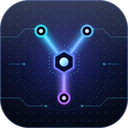

<p align="center"></p>

<p align="center">
<a href="https://github.com/sinabs/spring-agent-scope/actions/workflows/gradle.yml"></a>


<a href="LICENSE"></a>
</p>

<p align="center"><a href="README.md">English</a> | 简体中文</p>

## 关于 Yoke

**Yoke** · AgentHarness：基于 Spring Boot 和 [AgentScope Java](https://github.com/agentscope-ai/agentscope-java)（V2）的单体 Agent 服务。

> A Spring-based agent harness.

Yoke 是友客AI的开源项目。大家一起读 AgentScope Java V2 和 Spring 的源码，边学边做，做出一个能真正跑起来的 Agent 服务。Yoke（轭）原指套在牛马身上、让它们朝一个方向使劲的木架。Yoke 套在模型外面，让它稳定干活。

- 用 AgentScope Java 做 Agent，十几行代码就能跑通 Demo。真要给用户用，麻烦才开始：Agent 每个请求新建一个，还是全局共用一个？对话历史放哪？
- 流式输出、工具调用、多轮会话、权限收紧，官方文档里都是零散的例子。拼进一个 Spring Boot 项目，怎么分层、哪些边界必须守住，只能自己摸索。
- 官方 starter 一行就能引入，但它的入口没有认证，Agent 又是单例，原样上线，不同用户的会话会串在一起。哪些能用、哪些得自己写，这个项目会给出判断。
- 项目从一个能对话的接口起步，每课只解决一个工程问题，代码开源、能直接运行。没验证过的限制和踩过的坑，也写在文章里。

### 特性

- 一个接口完成多轮对话：`POST /api/chat`；另有 `POST /api/chat/stream`，按 AG-UI 协议通过 SSE 边推理边推送。
- 内置 `get_weather` 工具，通过开源的 [Open-Meteo](https://open-meteo.com) 查当前天气，免密钥（免费版仅限非商业使用）。
- 每次请求新建一个临时 `HarnessAgent`，用完即关闭。对话历史存在 Redis 里，重启不丢，多个副本共享，按 `(userId, sessionId)` 隔离，对话过长时自动压缩。
- 工具、知识库与子 Agent：计算器、时钟、按用户隔离的笔记工具，基于内置知识库的 `retrieve` 工具（返回带稳定片段编号的引用，形如 `[文档名.md#片段编号]`），通过 HTTP 接入外部 MCP 服务，以及两个子 Agent（一个在代码里声明，一个由工作区 Markdown 文件声明）。Agent 仍不开放文件、命令和联网工具，日志中间件为每次调用记录耗时轨迹。
- 互通能力，全部默认关闭：把 Agent 暴露成 A2A（Agent2Agent）服务、调用远端 A2A Agent、接入 Nacos 做 Agent Card 注册发现和 Prompt 热更新。Actuator 只暴露 `health`、`info`、`metrics`、`prometheus`。
- 通过 AgentScope 官方 starter 接入各种模型：OpenAI 兼容协议（可对接 DashScope、DeepSeek 等）、Anthropic、Gemini、Ollama，换依赖和配置即可。
- 有 local / test / prod 多环境配置；生产环境缺少密钥时启动即失败，避免带着空密钥上线。
- 默认开启虚拟线程，Tomcat 和 Spring 默认线程池都使用虚拟线程。

## 快速开始

需要 JDK 25 和 Docker（用于本地 Redis）。

```bash
docker compose up -d redis      # 先启动 Redis；没有 Redis 应用无法启动（要用 Nacos 相关功能再加上 `nacos`）
sdk env                         # 切换到 JDK 25（使用 sdkman 时）
export ARK_API_KEY=...          # local 环境接火山方舟（OpenAI 兼容协议）
./gradlew bootRun               # 默认激活 local 环境
```

```bash
curl -X POST localhost:8080/api/chat \
  -H 'Content-Type: application/json' \
  -d '{"message": "你好"}'
# {"sessionId":"…","reply":"…"}
```

后续请求带上返回的 `sessionId`，即可延续同一段对话。运行测试：`./gradlew build`；需要真实 Redis 的测试会通过 Testcontainers 读取同一份 `docker-compose.yml` 拉起，Docker 不可用时会明确跳过并写明原因（`CI=true` 时改为失败）。

### 会话

对话历史按 `(userId, sessionId)` 存放。请求体里两者都是可选的（`{"userId": "alice", "sessionId": "s-1", "message": "你好"}`），服务端保证二者到达 Agent 时都有值：

- 两个都传：用这一对
- 只传 `sessionId`：归属 `default` 用户（与旧版客户端行为一致）
- 只传 `userId`：为该用户新建一个会话，新的会话 ID 在响应里返回
- 都不传：`default` 用户下新建会话

不会把「只给其一」直接交给框架：AgentScope 里缺 `sessionId` 会落到以 Agent 名称命名的共享会话，缺 `userId` 会落到匿名用户，所有调用方的历史会混在一起。两个标识只能包含字母、数字、`_`、`.`、`-`，长度 1 到 64，且不能全是点（`.`、`..` 会被拒绝），否则返回 400。原因是框架把槽位拼成 `userId/sessionId`，允许 `/` 会让不同的一对撞到同一个槽位，`userId` 还会成为工作区的目录名。目前没有鉴权，`userId` 由调用方自报，不是身份校验。

每个会话在 Redis 里存了什么（用真实模型实测：两轮对话，其中一轮调用了工具）：

| 键 | 类型 | 内容 |
|---|---|---|
| `yoke:session:{userId}/{sessionId}:agent_state` | String | 一份 JSON，是整个 Agent 状态。对话在它的 `context` 数组里（一条消息一项：`USER`、带 `tool_use` 的 `ASSISTANT`、带 `tool_result` 的 `TOOL` 等），旁边是 `summary` 字段和几个空的上下文对象。真实压缩实测里 `summary` 一直是空的，压缩摘要是放在 `context` 的第一条消息里。两轮约 3.3 KB |
| `yoke:session:{userId}/{sessionId}:agent_state:ver` | String | 乐观并发用的版本号，每次保存递增 |
| `yoke:session:{userId}/{sessionId}:_keys` | Set | 该会话下所有状态键的名字（这里只有 `agent_state`），删除整个会话时靠它 |

模型的 `thinking` 内容和每条消息的 token 用量也会一并存下；每一轮都是整份读出、整份写回，所以会随对话变长而变大。没有单独的消息列表键。


### 流式调用（AG-UI）

`POST /api/chat/stream` 使用 [AG-UI](https://docs.ag-ui.com/concepts/events) 协议：请求体是标准的 `RunAgentInput`，响应是 `text/event-stream`，Agent 推理的同时就把 AG-UI 事件推送出来。用 `curl -N` 关闭缓冲：

```bash
curl -N -X POST localhost:8080/api/chat/stream \
  -H 'Content-Type: application/json' \
  -d '{"threadId": "demo", "runId": "run-1", "messages": [{"id": "msg-1", "role": "user", "content": "北京天气怎么样"}]}'
```

请求规则（任何一条不满足，都会在建立流之前返回 400）：

- `Content-Type` 必须是 `application/json`，否则返回 415。这也挡住了跨站页面用不触发 CORS 预检的 `text/plain` 请求发起对话
- `threadId` 就是会话 ID，必填：字母、数字、`_.-`，1~64 位，不能全是点。它与 `POST /api/chat` 的 `sessionId` 共用同一份历史（`default` 用户下；`RunAgentInput` 没有用户字段，流式接口固定以 `default` 用户运行）
- `runId` 必填且不能为空白（`RunAgentInput` 要求非空）
- `messages` 不能为空，每条消息都要有 `id` 和 `role`，最后一条必须是 `user` 消息且有非空白的纯文本。`content` 只能是字符串，内容块形式（全是文本块、带图片等）都会被拒绝
- 对话历史由服务端保存，只采用**最后一条** `user` 消息；前面的消息、`tools`、`context`、`state`、`forwardedProps`、`resume` 都会被忽略，客户端不能借此给 Agent 加工具或改写历史。这条消息也只取文本：它的 `id`、`toolCalls`、`toolCallId` 不会进入历史，消息 ID 由服务端生成。适配器还配置了 `ToolMergeMode.AGENT_ONLY`，只会用服务端注册的工具

示意输出（取值是编的，字段名来自桩模型的实际运行，较长的字段做了省略）。只发 `data:` 行，事件类型是 JSON 里的 `type` 字段，没有 SSE 的 `event:` 名：

```
data:{"type":"RUN_STARTED","threadId":"demo","runId":"…","input":{…}}

data:{"type":"TOOL_CALL_START","threadId":"demo","runId":"…","toolCallId":"call_1","toolCallName":"get_weather"}

data:{"type":"TOOL_CALL_ARGS","threadId":"demo","runId":"…","toolCallId":"call_1","delta":"{\"city\":\"北京\"}"}

data:{"type":"TOOL_CALL_END","threadId":"demo","runId":"…","toolCallId":"call_1"}

data:{"type":"TOOL_CALL_RESULT","threadId":"demo","runId":"…","toolCallId":"call_1","content":"\"晴，25 度（北京）\"","role":"tool","messageId":"…"}

data:{"type":"TEXT_MESSAGE_START","threadId":"demo","runId":"…","messageId":"…","role":"assistant"}

data:{"type":"TEXT_MESSAGE_CONTENT","threadId":"demo","runId":"…","messageId":"…","delta":"北京今天晴，25 度。"}

data:{"type":"TEXT_MESSAGE_END","threadId":"demo","runId":"…","messageId":"…"}

data:{"type":"CUSTOM","threadId":"demo","runId":"…","name":"token_usage","value":{"delta":{…},"cumulative":{"inputTokens":83,"outputTokens":27,…},"modelCall":{…}}}

data:{"type":"RUN_FINISHED","threadId":"demo","runId":"…"}
```

| 事件 `type` | 含义 |
|---|---|
| `RUN_STARTED` | 总是第一个事件，带 `threadId` 和 `runId` |
| `TEXT_MESSAGE_START` / `TEXT_MESSAGE_CONTENT` / `TEXT_MESSAGE_END` | 模型生成的文本；按顺序拼接 `CONTENT` 事件的 `delta` 即得到回复 |
| `TOOL_CALL_START` / `TOOL_CALL_ARGS` / `TOOL_CALL_END` | 模型决定调用的工具；`TOOL_CALL_ARGS` 的 `delta` 是入参 JSON 的片段，只有模型分片返回入参时才会出现 |
| `TOOL_CALL_RESULT` | 工具的执行结果，通过 `toolCallId` 与调用对应 |
| `CUSTOM`，`name` 为 `token_usage` | 每次模型调用结束后的 token 用量，含 `delta` 和 `cumulative` |
| `CUSTOM`，`name` 为 `hint` | 框架在推理过程中追加的提示，`value` 里有 `source` 和 `text` |
| `RUN_FINISHED` | 正常结束 |
| `RUN_ERROR` | 推理出错；HTTP 状态码仍是 200，流正常结束而不是断开连接。message 是原样的异常信息，未做脱敏，不要直接展示给终端用户 |

每次流都以 `RUN_STARTED` 开头（创建 Agent 失败时也一样），以 `RUN_FINISHED` 或 `RUN_ERROR` 结尾，二者不会同时出现。Agent 运行中出错时，`RUN_ERROR` 的 `code` 由 AG-UI 适配器按异常类型映射（`TIMEOUT_ERROR`、`INTERRUPTED_ERROR`、`INVALID_INPUT_ERROR` 或 `INTERNAL_ERROR`）；适配器之外的失败（例如创建 Agent 失败）一律是 `INTERNAL_ERROR`。没有 `done` 事件，也不重复最终全文：由客户端拼接 `TEXT_MESSAGE_CONTENT`。流正常结束、出错或客户端断开时，临时 Agent 都会被关闭。适配器的 `runTimeout` 配置在 AgentScope 里没有被读取，所以它不能限制运行时长。

> **不兼容变更**
> 流式接口原先的私有事件（`textDelta`、`toolCall`、`toolResult`、`hint`、`done`、`error`）和 `{"sessionId", "message"}` 请求体已经移除。流式接口现在只接受 `Content-Type: application/json`，不带 `Content-Type`、或者用 `text/plain`、`application/*+json` 的请求都会返回 415。`POST /api/chat` 的 `sessionId` 现在按 `threadId` 的同一条规则校验（以前 `user:42` 这类非空白值能通过，现在返回 400）；空白的 `sessionId` 仍然新建会话。

> **注意**
> 同一会话的并发请求不会被串行化，请避免同时发送。`HarnessAgent.close()` 会在每个请求的清理回调里等待框架全局的异步写入静默（两处各最长 5 秒），请求之间因此耦合；尚未做并发压测。

## 配置

配置按环境拆分，没有显式指定环境时默认激活 `local`；部署时用环境变量 `SPRING_PROFILES_ACTIVE=prod` 或命令行参数 `--spring.profiles.active=prod` 切换。

- `application.yml`：各环境通用：模型、Agent、虚拟线程、日志格式、工作区、键前缀、压缩、知识库向量化配置和（注释形式的）MCP 示例
- `application-local.yml`：本地开发：火山方舟的 `base-url` 与模型名写在文件里，密钥读环境变量 `ARK_API_KEY`（可为空），Redis 连 `redis://127.0.0.1:6379`（即 `docker-compose.yml` 里的那个），`com.yoke` 日志为 debug
- `application-test.yml`：自动化测试：假密钥，不会真正调用模型；Redis 地址由测试注入
- `application-prod.yml`：生产：密钥和 Redis 地址（`YOKE_REDIS_URI`）必须由环境变量提供，缺失则启动失败；优雅停机

模型由 AgentScope 官方 starter 根据 `agentscope.*` 创建，`HarnessAgent` 由 `HarnessAgentFactory` 每次请求新建（官方的单例 Agent 已关闭）：

| 配置 | 说明 |
|---|---|
| `agentscope.openai.api-key` | 模型密钥；`local` 读 `ARK_API_KEY`，`prod` 读 `OPENAI_API_KEY` |
| `agentscope.openai.model-name` | 模型名称 |
| `agentscope.openai.base-url` | 接入其他 OpenAI 兼容服务（DashScope、DeepSeek 等）时设置 |
| `agentscope.agent.sys-prompt` | 系统提示词 |
| `agentscope.agent.max-iters` | ReAct 最大迭代次数 |

Yoke 自己的配置使用 `yoke.*` 前缀：

| 配置 | 说明 |
|---|---|
| `yoke.redis.uri` | Redis 连接串。`prod` 下没有默认值（`YOKE_REDIS_URI`）；启动时连不上 Redis，应用直接启动失败 |
| `yoke.redis.key-prefix` | 所有 Redis 键的前缀，默认 `yoke:` |
| `yoke.compaction.trigger-messages` | 对话消息达到这个条数就压缩，默认 30 |
| `yoke.compaction.keep-messages` | 压缩后原样保留的最近条数，默认 10。小于等于 0，或保留条数不小于触发条数时，回落到默认值 |
| `yoke.workspace` | `HarnessAgent` 的工作区，放本地文件（转存的消息、记忆），默认 `~/.yoke/workspace`；只在本机，副本之间不共享 |
| `yoke.knowledge.embedding.model-name` / `api-key` / `base-url` / `dimensions` / `protocol` | 可选的向量化服务，用于向量检索。`protocol` 默认 `openai`（OpenAI 兼容的 `/embeddings`，可批量）；火山方舟的多模态向量模型（如 `doubao-embedding-vision-251215`）要写 `ark-multimodal`（`/embeddings/multimodal`，一条文本一次请求，`local` 环境默认就是它，复用 `ARK_API_KEY`）。`model-name` 和 `api-key`（`YOKE_EMBEDDING_API_KEY`）都有值才启用向量检索，否则只用关键词检索；运行中向量化服务出错时自动退回关键词检索 |
| `yoke.a2a.server.*` | A2A 服务端，**默认关闭**（`enabled`）。`token`（`YOKE_A2A_TOKEN`）是可选的 Bearer Token，`public-url` 是写进 Agent Card 的对外根地址，`timeout` 默认 120 秒，`card.*` 是名字、描述、版本和技能。详见 [A2A 与 Nacos](#a2a-与-nacos) |
| `yoke.a2a.remote.*` | 要调用的远端 A2A Agent：`url`（well-known 直连）或 `agent-name`（经 Nacos 发现），另有可选的 `token` 和 `timeout`（默认 30 秒）。默认都不配置，此时 `/api/chat/remote` 不存在 |
| `yoke.nacos.*` | Nacos 连接（`server-addr` 默认 `127.0.0.1:8848`、`namespace`、`username` / `password` 来自环境变量 `YOKE_NACOS_USERNAME` / `YOKE_NACOS_PASSWORD`）和开关 `a2a.enabled`、`prompt.enabled`（及 `prompt.key`），全部默认关闭且互不绑定 |
| `yoke.mcp.servers[]` | 外部 MCP 服务，默认一个也不接。每项有 `name`、`transport`（只能是 `sse` 或 `streamable-http`）、`url`、`timeout`（默认 30 秒）和可选的 `headers`。配置 `stdio` 会让应用启动失败；服务连不上同样启动失败 |

Agent 创建时不开放文件、命令和联网工具。读 AgentScope 源码发现子 Agent 只继承文件和 shell 的关闭、不继承联网工具的关闭，所以联网工具除了主 Agent 的 `disableWebTools()`，还用 `ToolsConfig` 的 deny 名单禁掉，它同时作用于主 Agent、内置的 `general-purpose` 子 Agent 和所有声明的子 Agent。显式传入 `ToolsConfig` 还会让 AgentScope 不再去读工作区里的 `tools.json`（那个文件可以声明 `stdio` MCP 服务，也就是在宿主机上启动进程）。读类的记忆和会话工具（`memory_get`、`memory_search`、`session_history`、`session_list`、`session_search`）也被同一份 deny 名单拒绝：`memory_get` 只校验路径不越出工作区根目录、不校验是否在当前用户目录下，`session_history` 把模型给的 ID 直接拼进路径，开着就能让模型读到别的用户的记忆和会话。模型看到的工具恰好是：Yoke 自己的（`get_weather`、`get_current_time`、`calculate`、`list_my_notes`、`retrieve`），框架的写记忆、技能加载、异步结果、子 Agent 和后台任务类工具（`memory_save` 只往工作区固定的 `MEMORY.md` 与 `memory/<日期>.md` 追加，内容没有大小限制），再加上所配置的 MCP 服务公布的工具。`ToolPermissionTests` 用精确集合断言这份清单，框架升级新增了工具会让构建失败。容器里的 `MiddlewareBase` Bean 会挂到每个新建的 Agent 上；`LoggingMiddleware` 记录 Agent、模型、工具的耗时，不记录工具的参数和输出。OpenTelemetry 追踪默认不挂载：需要时自行引入 OpenTelemetry SDK 和导出器，再注册一个 `OtelTracingMiddleware` Bean。

## 工具、知识库与子 Agent

- **工具**（`com.yoke.tool`）：带 `@Tool` 方法的普通类，启动时一次性注册进共享的 `Toolkit`。`calculate` 用手写的递归下降解析器（不用脚本引擎，输入长度和嵌套深度有上限，除零以文本形式报告）。`list_my_notes` 的 `UserContext` 参数不带 `@ToolParam`：框架按类型从本次请求的 `RuntimeContext` 里注入，模型既看不到也伪造不了用户标识。
- **检索**：`retrieve` 工具检索 `src/main/resources/knowledge/*.md`，返回带稳定编号（形如 `[文档名.md#片段编号]`，文档名加正文摘要，正文改了编号也跟着变，旧引用不会指到别的内容上；不同 classpath 根里有同名知识文档时启动即失败）和来源的片段，并要求模型原样照抄编号引用；同一轮对话里多次检索编号也不会重复，不像每次从 `[1]` 开始的序号会冲突。它是唯一的检索通道，有意不同时使用框架的 `knowledge()` 自动注入。检索分层放在应用自己的 `RetrievePort` 后面（不含框架类型）：BM25 关键词检索永远可用；配置了向量化服务就再加一路向量检索，两路用 RRF（常数 60）融合，任何一路失败就用另一路。注意开启向量化后，用户的检索问题和知识库语料会发送给 embedding 服务提供方。没有使用框架自带的 `rag-simple`：`core/rag` 包在 AgentScope 里已 `@Deprecated(forRemoval = true)`，而且该模块会拖进 Qdrant、Milvus、Elasticsearch、PostgreSQL、PDFBox、POI、Tika 等一大批依赖。
- **MCP**：只接受 HTTP 传输。示例：

  ```yaml
  yoke:
    mcp:
      servers:
        - name: docs
          transport: streamable-http   # 或 sse
          url: https://mcp.example.com/mcp
          timeout: 30s
          headers:
            Authorization: Bearer ${MCP_DOCS_TOKEN}
  ```

  工具以服务端公布的名字出现。AgentScope 里 MCP 工具只有服务端声明了 `readOnlyHint` 才会免确认执行，而 Yoke 的 HTTP 接口没有人工确认通道（否则一轮对话会在工具调用处无声结束、回复为空）。所以只注册声明了只读的工具，其余跳过（工具名记在 INFO 日志里），主 Agent 和子 Agent 都看不到它们。公布的工具与 Yoke 自己的工具或 Harness 内置工具（`memory_save`、`agent_spawn` 等，每次请求建 Agent 时才加进去）重名时，启动失败。
- **子 Agent**：`summarizer` 在代码里声明（`YokeSubagents`），没有任何工具；`kb-researcher` 由 `src/main/resources/workspace/subagents/kb-researcher.md` 声明，启动时拷贝到 `yoke.workspace/subagents/`，只能用 `retrieve`。AgentScope 对同 id 冲突是静默的：工作区文件会覆盖代码里的声明（`general-purpose.md` 还会替换内置的那个），所以 Yoke 会扫描 `yoke.workspace/subagents/` 里实际存在的全部文件（包括遗留的、手放的，不只是随应用发布的那几个），遇到任何这类重名都直接启动失败。

要换成其他模型，把 `build.gradle` 里的 `agentscope-openai-spring-boot-starter` 换成对应的 starter（dashscope、anthropic、gemini、ollama），并修改 `agentscope.model.provider`。

## A2A 与 Nacos

本节的能力**默认全部关闭**。

### A2A 服务端

```bash
export YOKE_A2A_TOKEN=$(openssl rand -hex 24)
./gradlew bootRun --args='--yoke.a2a.server.enabled=true --yoke.a2a.server.public-url=http://localhost:8080'
```

开启后多出两个端点：`GET /.well-known/agent-card.json`（公开）和 `POST /a2a`（JSON-RPC，只处理 `message/send`），契约写在 `A2aApi` 里。

> **警告**
> 开启就是暴露一个**无认证**的入口，能力等价于 `/api/chat`（同一批工具、同一个历史存储），调用方还能自报任意 `userId`。生产必须放在网关后面，或者至少配置 `yoke.a2a.server.token`：配置后 JSON-RPC 端点要求 `Authorization: Bearer <token>`（常量时间比较，否则 401），Agent Card 里同步声明 Bearer 认证。不配置 token 就不做任何校验，启动时会打一条 WARN。

- 协议：AgentScope 实现的是 A2A 0.3（SDK `0.3.3.Final`，`protocolVersion` 为 `0.3.0`），只有 JSON-RPC 传输。以上以 Yoke 当前使用的 AgentScope 为准，更新版本的 AgentScope 已改为 A2A 1.0、不再支持 0.3，请以对应版本的手册为准。只提供同步的 `message/send`（Card 里 `streaming: false`）；`message/stream` 和 `tasks/resubscribe` 返回「不支持的操作」，其余方法返回「方法不存在」。
- 传输安全：Bearer Token 走明文 HTTP，`public-url` 缺省是 `http://localhost:端口`。生产要用 `https` 的对外地址，或由网关终结 TLS。token 少于 16 个字符会启动失败。请求体超过 `yoke.a2a.server.max-body-bytes`（默认 256 KB）返回 413（响应体 `-32600`）：认证先于读体，声明的 `Content-Length` 超限不读体，chunked 请求限长读取；`/api/chat` 没有这类自定义上限。
- 会话：`sessionId` 取 `metadata.sessionId`，没有则取 `contextId`，再没有就新建；`userId` 取 `metadata.userId`，缺失为 `default`。二者和 HTTP 接口用同一条 `@SafeId` 规则，不合法返回 `-32602`。响应里的 `contextId` 就是会话 ID，带上它即可延续对话。
- 失败返回 JSON-RPC 的 `-32603`，消息是固定的一句话，不含异常内容。
- 没有使用官方的 `agentscope-a2a-spring-boot-starter`：它只认 `ReActAgent`，自带的控制器没有认证，Card 里的 `streaming` 还固定写成 `true`。

### 调用远端 A2A Agent

配置 `yoke.a2a.remote.url`（或 `agent-name` 并开启 `yoke.nacos.a2a.enabled=true`）后出现 `POST /api/chat/remote`：`{"sessionId": "...", "message": "..."}`。调用目标只来自配置，请求体里没有任何字段能影响它。直连 URL 时，远端 Agent Card 里**所有**声明服务地址的位置（`url` 和 `additionalInterfaces` 的每一项）都必须与配置同源，且首选传输必须是 JSONRPC，否则拒绝调用（官方客户端从首选传输和 additionalInterfaces 里挑 JSON-RPC 地址，只比较 `url` 会被绕过）。HTTP 客户端不跟随重定向，请求有超时。失败返回 `502`（超时 `504`），响应里不含地址和凭证。这个端点同样没有认证。它有意不作为工具暴露给模型，免得远端的内容左右模型。

### Nacos

```bash
docker compose up -d redis nacos        # Nacos 3.x 单机，固定 v3.2.1-2026.03.30
export YOKE_NACOS_ADDR=127.0.0.1:8848
./gradlew bootRun --args='--yoke.nacos.prompt.enabled=true --yoke.nacos.a2a.enabled=true --yoke.a2a.server.enabled=true'
```

- 一条 gRPC 通道承载全部数据，需要 Nacos 3.x（客户端端口 = 主端口 + 1000，默认 9848）。任何一个开关打开，启动时都会探活，不可用就启动失败，报错信息清晰且不含凭证。
- `yoke.nacos.a2a.enabled`：A2A 服务端开启时，应用就绪后注册 Agent Card 和端点（关闭时注销）；配了 `yoke.a2a.remote.agent-name` 时按名字发现远端。
- `yoke.nacos.prompt.enabled`：每轮对话从 Nacos 拉取 Prompt `yoke.nacos.prompt.key`，追加在内置系统提示词之后（不重复拼接；拉取失败就原样使用内置提示词）。发布新版本后，下一轮对话即可生效，中间有很短的服务端传播延迟（对 compose 里的镜像实测 25 到 270 毫秒）。
- 信任边界：谁能写 Nacos 里这个 Prompt Key，谁就能改 Yoke 的系统提示词（它追加在内置提示词之后，实测子 Agent 也会带上）。来源必须受信，生产必须开启 Nacos 鉴权。每次拉取有超时（`yoke.nacos.prompt.timeout`，默认 2 秒），超时或失败沿用内置提示词，警告日志有限频。
- Nacos 客户端的日志和快照缓存被重定向到 `<yoke.workspace>/nacos`（`JM.LOG.PATH`、`JM.SNAPSHOT.PATH`），不再写 `~/logs/nacos` 和 `~/nacos`。客户端自己登录失败的那行日志仍会显示打码后的部分密码。
- Skill 托管（`nacos-skill`）没有接入。
- `docker-compose.yml` 里的 Nacos 关闭了鉴权，仅限本地研发；生产必须开启鉴权并替换其中的占位密钥。

### 可观测

Actuator 只暴露 `health`、`info`、`metrics`、`prometheus`（`ActuatorExposureTests` 精确断言），`env`、`heapdump` 之类一律不暴露；`health` 包含 Redis，但不显示明细。这些端点和业务接口在同一个端口，同样没有认证：请放在网关后面，或用 `MANAGEMENT_SERVER_PORT` 挪到内部端口。

## 项目结构

```
src/main/java/com/yoke/
├── YokeApplication.java        应用入口
├── a2a/                        A2A 服务端网关、runner（a2a/runner 把 HarnessAgent 适配成 A2A 的 AgentRunner）和远端客户端
├── api/                        HTTP 接口契约（ChatApi、A2aApi、RemoteChatApi，路径、校验和文档都在这里）
├── codec/                      领域类型与框架类型之间的转换（MessageCodec、AguiStreamCodec、HintEventConverter）
├── config/                     Agent、Redis、AG-UI、A2A、Nacos、工具、知识库与子 Agent 配置（HarnessAgentFactory、YokeProperties、YokeSubagents）
├── controller/                 接口实现（ChatController、A2aController、RemoteChatController）
├── knowledge/                  检索端口及实现：关键词、向量、RRF 融合（不含框架类型）
├── mcp/                        到外部 MCP 服务的连接（只支持 HTTP 传输）
├── middleware/                 Agent 中间件（LoggingMiddleware）
├── nacos/                      Nacos 客户端探活、A2A 注册、Prompt 热更新中间件
├── model/                      领域、请求与响应对象（ChatRequest、ChatResponse、RemoteChatRequest、SafeId、UserContext、Passage）
└── tool/                       暴露给模型的工具（WeatherTool、ChatTools、RetrieveTool、SharedToolkit）
src/main/resources/             application.yml、各环境配置、knowledge/*.md 和 workspace/subagents/*.md
docker-compose.yml              本地 Redis 和 Nacos，集成测试也用它
docs/brand/                     logo
```

## 了解更多

- [AgentScope Java 文档](https://java.agentscope.io)：Agent、工具、权限、状态存储等能力的完整说明。
- [AgentScope Java 快速开始](https://java.agentscope.io/v2/zh/docs/quickstart.md)。

## 参与贡献

欢迎提交 Issue 和 Pull Request。提交前请运行 `./gradlew build` 确保全部测试通过；代码注释使用中文。AgentScope 的消息和事件类型不能泄漏到 `codec` 之外（`middleware` 除外，它的钩子签名本身就要用这些类型），`knowledge` 包不能出现任何 AgentScope 类型，`a2a` / `nacos` 包只能用明确白名单里的框架类型，`ArchitectureTests` 会检查这些。Nacos 集成测试会用 `docker-compose.yml` 里的 `nacos` 服务（第一次拉镜像较慢）。

## 许可证

Yoke 是基于 [Apache License 2.0](LICENSE) 开源的软件。

## Star 趋势

[](https://star-history.com/#sinabs/spring-agent-scope&Date)
